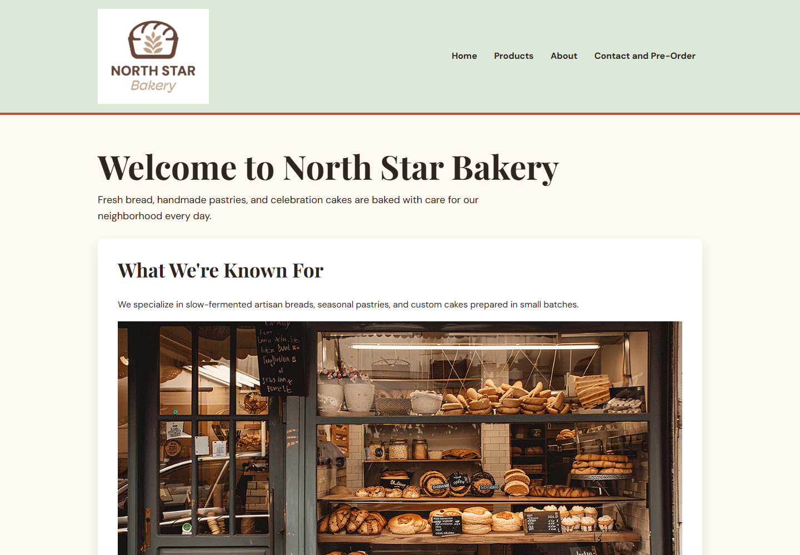

# Touchstone 3: Visual Design and Responsive Layout

**Name:** Taufiq Uddin  
**Course:** Introduction to Web Development  
**Date:** October 6, 2026  
**Selected Client:** Client A — North Star Bakery  

## Section 1: GitHub Link

Paste the public GitHub repository URL here after publishing the `North_Star_Bakery_HTML_Files` folder: **[Add public repository URL]**

## Section 2: Design Explanation

### Client Alignment

North Star Bakery needs to feel like a friendly, dependable neighborhood business for customers looking for fresh bread, pastries, cakes, and pre-order information. The soft cream background, sage header, and warm terracotta action color create a welcoming, handmade feeling without making the site look crowded. On every page, the navigation remains in the same clear location and the content is grouped into white cards, so a visitor can quickly find products, the bakery story, or the pre-order form. The contact page makes the most important task especially clear with readable fieldsets, labels, and a high-contrast “Send Request” button.

### Color Palette

The four main colors are cream (`#FFFAF1`), dark brown/ink (`#2F241F`), sage green (`#DCE8DA`), and terracotta (`#B65335`). Cream and white provide calm, uncluttered reading surfaces, while the dark ink color creates strong contrast for body text and headings. Sage is used for the shared header to give the site a natural, neighborhood-bakery tone. Terracotta is reserved for links, the header accent, and the form button so that key actions are easy to notice.

### Typography

The site uses two font families: Playfair Display for headings and DM Sans for body copy, navigation, and form controls. Playfair Display adds a warm, traditional bakery character to page titles and section headings, while DM Sans stays simple and legible for longer text. The page title is larger than the section headings, and each section heading is larger than its supporting paragraph text, creating a clear reading order. The navigation and form labels use a stronger weight so customers can scan choices and inputs quickly.

### Responsive Design

The layout starts with a mobile-first design: the header stacks the logo above a two-column navigation menu, and the content uses a single readable column. Flexbox is used for the header and for the larger-screen navigation, while the compact mobile menu uses two even columns so the longer “Contact and Pre-Order” label remains usable. At `48rem` and above, a media query changes the header to a side-by-side layout, adds more space around the main content, and increases section padding. Images, audio, and video are constrained to the available width so they remain usable on both small and large screens.

### Design Challenge

The main challenge was keeping four pages with very different content—products, a video, an audio message, and a pre-order form—visually consistent. I solved this by using one shared external stylesheet and applying the same header, navigation, card-style sections, heading hierarchy, and footer treatment across the whole site. The form needed extra care on small screens, so inputs and textareas use full available width while radio buttons keep their natural compact size. Visible keyboard focus outlines were also added so visitors can tell where they are when navigating without a mouse.

## Section 3: Submission Checklist

- [x] Updated HTML files
- [x] External CSS file
- [ ] Working preview link (start a local preview in your IDE)
- [x] Consistent color palette (four colors)
- [x] Consistent typography (two font families)
- [x] Styles applied across all pages
- [x] Flexbox used in layout
- [x] Media queries included
- [x] Readable text with sufficient contrast
- [x] Completed design explanation

## Section 4: Screenshot

The included desktop preview shows the sage header, terracotta accent line, and white content card used to create a warm but readable bakery design. Insert this image into the supplied Touchstone 3 template; it directly supports the color-palette and responsive-design explanations above.

## Section 5: Final Review

- [x] Navigation uses working relative links across all pages
- [x] Layout uses mobile-first styles and larger-screen media queries
- [x] Design is consistent and readable
- [x] Course-provided Bakery media files included and linked with correct relative paths
- [ ] Paste the public GitHub repository link into the supplied Touchstone 3 `.docx` template before submission
